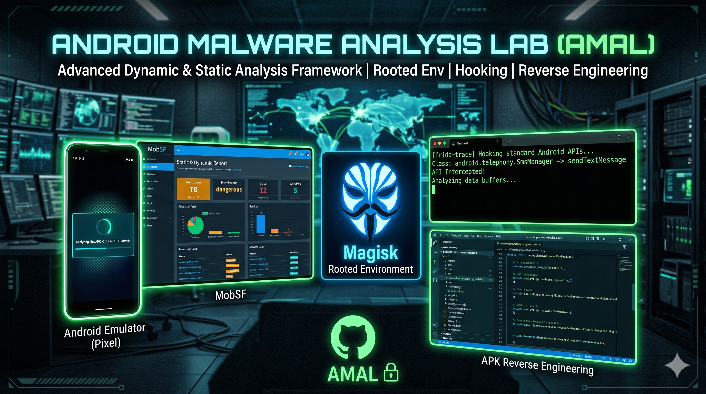

<p align="center">
  
</p>

<h1 align="center">MobSF Android Analysis Lab</h1>

<p align="center">
  Automated Android Static & Dynamic Analysis Environment
</p>

<p align="center">
  
  
  
  
  
</p>

---

## About

A fully automated Android malware analysis & mobile security research lab.

This setup installs:

- Android Emulator
- Android SDK
- RootAVD
- Magisk
- Docker
- MobSF

Built for:

- Malware Analysis
- APK Reverse Engineering
- Dynamic Runtime Analysis
- SSL Pinning Bypass
- Frida Instrumentation
- Mobile App Pentesting

---

## Installation

### One-Line Setup

```bash
bash <(curl -fsSL https://raw.githubusercontent.com/stukryptx/mobsf-android-analysis-lab/main/install_android_env.sh)
```

---

## What Gets Installed

| Component | Purpose |
|---|---|
| Android SDK | Android tools |
| Emulator | Virtual Android device |
| RootAVD | Root patching |
| Magisk | Systemless root |
| Docker | Container runtime |
| MobSF | Mobile Security Framework |

---

## Emulator Details

| Property | Value |
|---|---|
| Name | MOBSF_DEV |
| Android | 11 |
| API | 30 |
| Architecture | x86_64 |
| Device | Pixel 7 Pro |

---

## Start Emulator

```bash
emulator -avd MOBSF_DEV
```

---

## Important Magisk Setup

After emulator boots:

1. Open **Magisk App**
2. Wait few seconds
3. Popup appears
4. Click **Reboot**
5. Verify root:

```bash
adb root
```

---

## Start MobSF

```bash
docker run -it --rm -p 8000:8000 \
opensecurity/mobile-security-framework-mobsf:latest
```

Open:

```text
http://127.0.0.1:8000
```

---

## Dynamic Analysis Ready

Supports:

- Frida
- Objection
- Burp Suite
- mitmproxy
- SSL Pinning Bypass
- Runtime Hooking

---

## Project Structure

```text
mobsf-android-analysis-lab/
├── README.md
├── install_android_env.sh
├── oneliner.sh
├── LICENSE
└── images/
    └── banner.png
```

---

## Credits

- RootAVD
- MobSF
- Android Emulator
- Magisk

---

## Disclaimer

For educational purposes, malware analysis, and authorized security research only.

---

<p align="center">
  Built for Android Security Researchers
</p>
